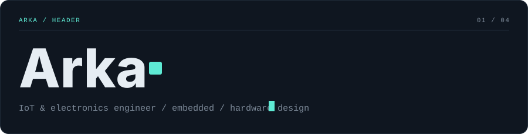
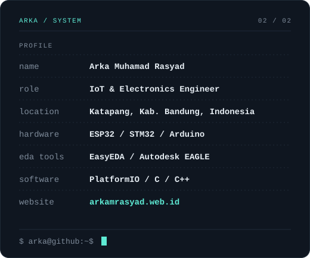
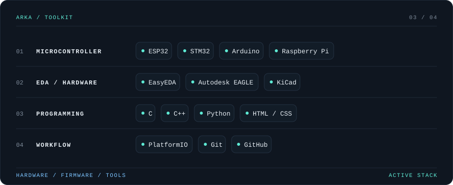
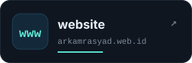
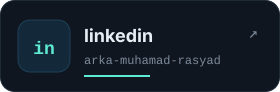
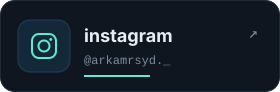
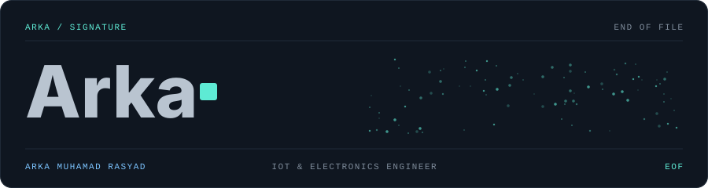

 

 

## `// PROJECTS`

| # | Project | Stack | Link |
|---|---------|-------|------|
| 01 | **SISABET**: sistem informasi berat, tinggi, dan temperatur. Dokumentasi pemrograman dan desain hardware. | C++ · Embedded · Sensor | [Open repository →](https://github.com/Arka170508/SISABET-Sistem-Informasi-Berat-Tinggi-dan-Temperature-) |
| 02 | **Agrisense Firmware V2.1**: firmware untuk perangkat monitoring pertanian. | C++ · IoT · Firmware | [Open repository →](https://github.com/Arka170508/Agrisense-Firwmware-V2.1) |
| 03 | **Personal Portfolio**: website pribadi untuk menampilkan proyek dan skill. | HTML · CSS · Web | [Open repository →](https://github.com/Arka170508/Arka-Muhamad-Rasyad.github.io) |
| 04 | **More experiments**: eksplorasi elektronika, pemrograman, dan eksperimen teknis lainnya. | Explore · Learn · Build | [Browse all →](https://github.com/Arka170508?tab=repositories) |

 

## `// GITHUB METRICS`

 

## `// CONNECT`

  

